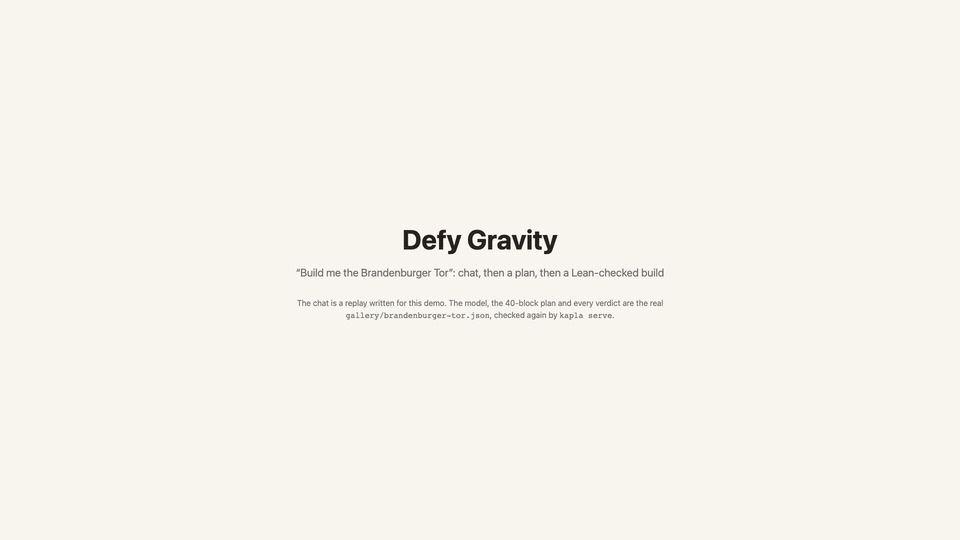

# Brandenburg Gate demo



Video: [brandenburg-demo.mp4](brandenburg-demo.mp4) (71 s, 1920 × 1080)

A user asks the chat for the Brandenburger Tor with 40 blocks, the `ai` planner proposes a plan,
and the plan is built one block per step. Next to the 3D view, a Lean panel shows the statement of
`coreCheck_ok_sound` and the goal for each step (`TWellFormed (tb.take k) ∧ TStable (tb.take k)`).
Block 40 is turned by about 45°, so the check takes the `nominal` branch (`TSafePlan`).

The plan is the gallery entry `gallery/brandenburger-tor.json` (40 planks, `planner: "ai"`),
unchanged since commit `63835a9`. The verdicts in the video come from `kapla serve` built from
that commit (`GET /gallery/brandenburger-tor`):

```
stands: true, assurance: nominal, hardToReach: false
Physics (verified): well-formed and stands after every block, at the planned positions only (turned blocks: placement errors, gaps and reach not checked)
score: 2147/3574 (≈ 0.60, coarse), accepted, 40 blocks, height 26
```

The plan and the verdicts are what the checker verifies. The rest is a replay for viewing: the
chat text is written for the demo, the page is a mock-up styled like the website, and the list of
per-step goals illustrates what `TSafePlan` states (the checker runs once on the whole plan).
