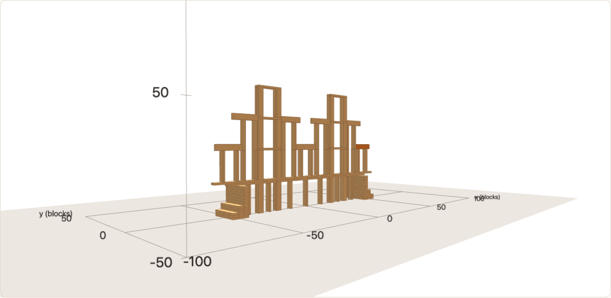

# Kapla suspension bridge

A 153-block suspension bridge, designed by hand from a reference image of a Kapla bridge.
Gallery entry: `gallery/kapla-suspension-bridge.json`. Generator: `bridge_build.py`
(`python3 -I bridge_build.py b9 OUT.json` writes the blueprint).

- **Towers:** two, 15 wide, each with two legs (3 × 3, uprights) and three levels with a flat
  crossbeam on each. The deck passes between the lower and upper legs.
- **Deck:** two layers of flats, x from −60 to 60, 15 above the ground.
- **Piers:** seven slim ones under the deck (one upright each). See "Physics" for why.
- **Hangers:** thin uprights, 15 or 30 tall, two under each cable segment.
- **Cable:** edge blocks at two levels (deck + 15 and deck + 30) that meet the towers.
- **Anchors:** stepped blocks at both ends.

## How it was made: likeness first, then the must-have constraints

1. **Phase 1, look only (b1–b4).** Match the image, ignoring physics (no overlaps allowed).
   Every Kapla block has a 15-unit side and blocks never lean, so the image's curved cable,
   X-braces and thin stacked hangers cannot be copied exactly. Plank stacks pointing across the
   bridge (b1–b3) read as walls from any angle, so the hangers became thin uprights (b4). Uprights
   only come 15 tall, which gives the cable two levels.
2. **Phase 2, must-have violations, one at a time** (the build after every step must be
   well-formed and stable at the planned positions; at most 200 blocks; one block per step):

   | Version | Violation | Fix |
   |---|---|---|
   | b4 → b5 | the deck cannot hang from the cable: contacts only push, and there is no friction | slim piers under the deck (x 0, ±12, ±40) |
   | b5 → b6 | a deck plank between the tower legs has nothing under its centre | a pier inside each tower (x ±27) |
   | b6 → b7 | side hangers stand one unit above the lower deck layer, on nothing | the upper deck layer goes out to x ±60 |
   | b7 → b8 | a side-span cable segment overhangs its last hanger | hangers re-spaced so each segment has support on both sides of its centre |
   | b8 → b9 | (look) towers no taller than the cable, too many hangers | a third tower level; two hangers per segment |

3. **Relaxed (reported, not fixed):** stability with 3.9 mm placement errors, gaps and reach.
   There are 18 near-miss gaps.

## What was checked

Checked with the verified engine functions (`TWellFormed`, `tStands`, the parts of
`checkTurnedPlan`), run as compiled code:

- **The finished build:** well-formed and stable at the planned positions; no overlaps; one block per step.
- **Every step from 1 to 111** (anchors, legs, piers, deck, the first two tower levels): the
  build after each of them is well-formed and stable at the planned positions.
- **Not checked:** steps 112–153 (third tower level, hangers, cable) one by one. So
  `checkTurnedPlan 200` (which would give `TSafePlan` through `checkTurnedPlan_sound`) has not
  been run to the end: it takes many minutes on this build.

**What the website shows today:** "Does not stand". For plans with only right-angle turns, the
site uses the check with placement errors, which certifies nothing resting on an upright. With
#70 it would also run the check at the planned positions in the background.

## Likeness

The design follows the image, not a bubble model. The gallery format needs a model, so
`kapla-suspension-bridge` is a rough 12-bubble trace around the bridge (deck, towers, anchors,
cable segments). Against it the score is 0.46 and the plan is "Not accepted", because the thin
hangers and the piers lie outside those bubbles. The number does not measure the likeness to the
image.
