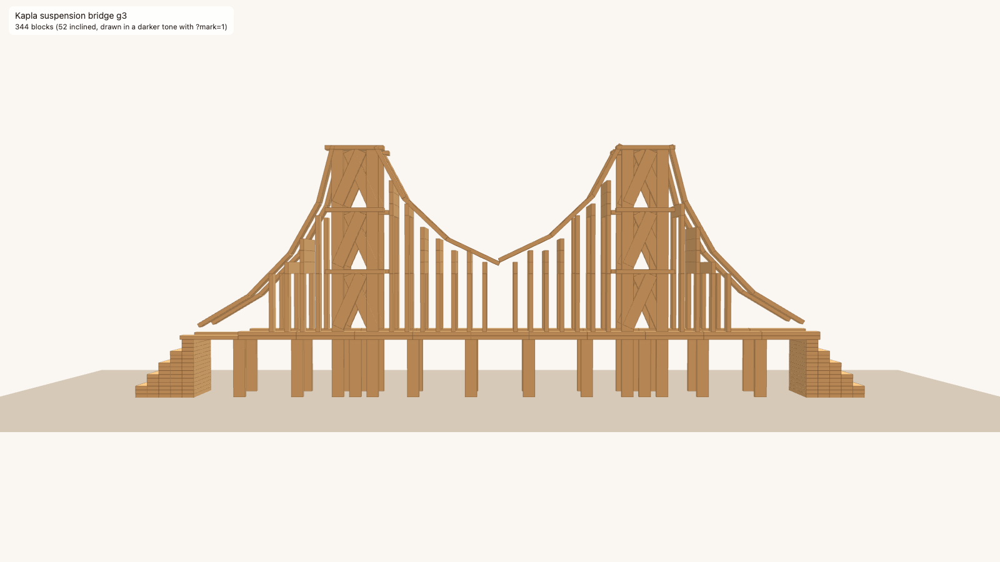

# Kapla suspension bridge with inclined blocks (demo)

A 344-block suspension bridge in the style of the Golden Gate, designed from a reference image:
292 axis-aligned blocks and 52 **inclined** blocks (the cable and the X-braces). Open
`viewer.html` in a browser: drag to turn; `?view=side`, `?view=low` or `?view=q` choose the camera,
and `?mark=1` draws the inclined blocks in a darker tone.

**This is a demo, not a gallery entry.** The project's format, viewer and physics allow turns
about the vertical axis only (B4/B6: blocks never lean), so the inclined blocks cannot be stored
in a blueprint or drawn by `kapla view`. They live in `plan-with-inclined.json`, and
`viewer.html` (from `make_tilt_viewer.py`) draws them.

## The build

- **Towers:** two, each with four legs (uprights, at x = ±4.5 and y = ±6 from the tower
  centre) and three levels with a flat crossbeam front and back. **X-braces** in every panel,
  front and back: two inclined edge blocks per panel, 1 apart across so they cross (24 blocks).
- **Cable:** inclined flat planks, front and back (28 blocks). Kapla planks are 15 long, so the
  cable is a polygon of 15-long chords whose angles change evenly. Main span: three chords per
  side at 25°, 44° and 62°, from the lowest point (z 35) to the tower tops (z 65). Side spans:
  four chords down to near the anchors.
- **Hangers:** thin uprights (1 wide from the side), front and back, with spacer blocks on top so
  that they reach the cable.
- **Deck:** two girders (front and back), each two layers of flats, on slim piers at the girder
  joints.
- **Anchors:** stepped blocks at both ends.

Generator: `golden_build.py` (`python3 -I golden_build.py g3 AXIS.json WITH_INCLINED.json`).
`plan-axis-aligned.json` is a normal blueprint of the 292 axis-aligned blocks.

## What was checked

- **The axis-aligned part (292 blocks)**, with the verified engine functions (`TWellFormed`,
  `tStands`, the parts of `checkTurnedPlan`), run as compiled code:
  - the finished structure is well-formed and stable at the planned positions;
  - no overlaps, one block per step;
  - no near-miss gaps and no tight slots.
- **Not checked:**
  - **the 52 inclined blocks.** The model has no tilted blocks, and a leaning plank is held
    partly by friction, which the model leaves out (F3). Nothing about them is proved.
  - **each step one by one.** Only the finished structure was checked, so there is no
    `TSafePlan` certificate.
- **Over the Kapla box:** 344 blocks is more than the 200 of K5. `kapla check` and the website
  refuse plans with more than 200 blocks.

## Differences from the image

- **The cable's lowest point** is 18 above the deck (about 6 in the image). With 15-long chords, a
  deeper dip makes the cable almost vertical at the towers.
- **The hanger tops:** the spacer blocks span front to back, so close up they form small panels.
- **The piers** under the deck show from the side. A deck cannot hang from the cable in this model
  (contacts only push), so it is held from below.
