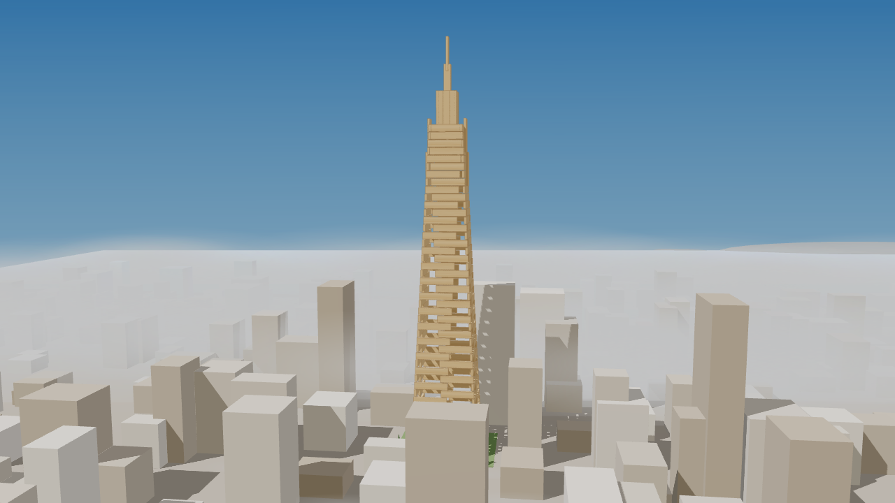
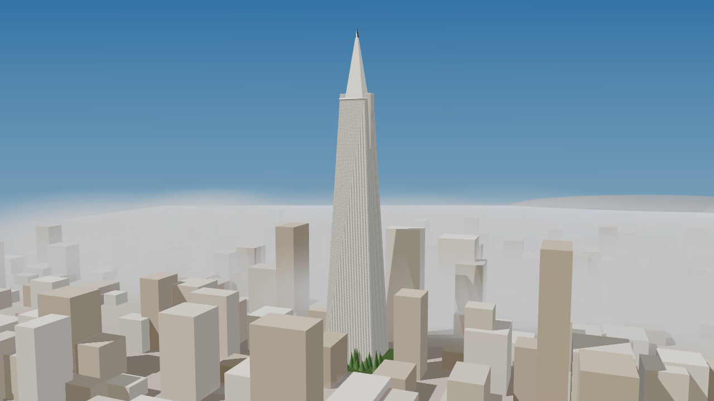

# Transamerica Pyramid look-alike (concept, physics unchecked)

Video: [transamerica-concept.mp4](transamerica-concept.mp4) (22 s)

The plan is the gallery entry `gallery/transamerica-pyramid-unchecked-physics.json`
(200 planks, `planner: "ai-unchecked"`). It was designed to look like the building, and physics
was ignored on purpose.

**This plan is not checked.** It has not been run through `kapla check` in this PR. An earlier
local check of the same plan failed (exit 1): 31 pairs of planks overlap, 28 pairs have a small
gap that a 3.9 mm placement error could close, and the build is not shown to stand after step 5.
Do not show it as a proven build.

The video and the stills are a design concept. The white skin is decoration drawn over the
planks; it is not part of the plan and nothing checks it.
